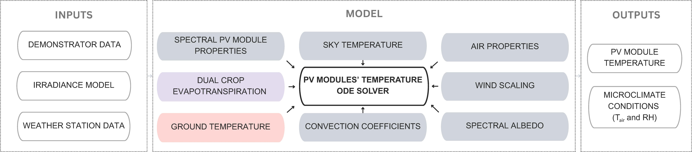

<p align="center">
  
</p>

<h1 align="center">HMT-Agrivoltaics</h1>

<p align="center">
  <strong>Heat &amp; Mass Transfer Modelling in Agrivoltaic Orchards</strong>
</p>

Heat and mass transfer (HMT) model for the operating temperature of semi-transparent PV modules above orchards and the
microclimate beneath them, in open-field agrivoltaic systems. The model couples the energy balance of each module along a
row, the air flow beneath the modules, a 1D soil heat diffusion model and a FAO-56 dual crop-coefficient
evapotranspiration model.

The repository contains the developed code (Python functions) and a demonstration notebook that gives a step-by-step
overview of the model.

The evapotranspiration functions use the FAO-56 methodology, partly through the open-source
[pyfao56](https://github.com/kthorp/pyfao56) library.

Open use of this repository is encouraged, provided appropriate acknowledgment is given to: M. Amorós-Trepat et al., under peer review (2026).

## Repository structure

- `demonstration.ipynb`: step-by-step demonstration of the model on one artificial day.
- `example_input_1day.csv`: hourly time series of the demonstration (one artificial clear summer day).
- `functions_module.py`: heat and mass transfer model: module optics and thermal mass, air properties, convection
  correlations, sky and ground radiation, soil temperature, irradiance, and the module temperature solver `Tm_model`.
- `ET_func.py`: evapotranspiration (FAO-56 reference evapotranspiration and dual crop coefficient).
- `ET_files.py`: input files for pyfao56 and CROPWAT (weather, crop parameters, irrigation).
- `func_check.py`: comparison models (Fuentes), statistics and check plots.

## Quick start

### 1) Clone the repository
```bash
git clone https://github.com/marta2amoros/HMT-Agrivoltaics.git
cd HMT-Agrivoltaics
```

### 2) Create a Python environment (recommended)
```bash
python -m venv .venv
```

### 3) Install dependencies
```bash
pip install pvlib pandas numpy psychrolib matplotlib scipy tmm thermo pyfao56 CoolProp openpyxl jupyter
```
The code was tested with Python 3.13, pvlib 0.16, pandas 3.1, numpy 2.5 and pyfao56 1.4.

### 4) Run the demonstration
```bash
jupyter notebook demonstration.ipynb
```
Run the cells from top to bottom. The results are written to `Results/Results_demonstration_1day.csv`.

## Model structure

<p align="center">
  
</p>

The demonstration follows the model in six steps:

1. **System properties**: geometry of the row, optical properties of the module and its layer stack, crop growth stages
   and crop coefficients, and soil properties. The thermal mass follows from the layer stack (`thermal_mass_PV`) and
   the module absorptance from the cell and glass absorptances (`absorption_avg`).
2. **Time series inputs**: weather, irradiance, precipitation and irrigation, read from `example_input_1day.csv`.
3. **Ambient air properties** at each hour (`calc_air_properties`).
4. **Soil-crop system**: reference evapotranspiration (`ET_func.ET0_calc`, FAO-56 Penman-Monteith), basal crop
   coefficient (`ET_func.Kcb_calc`), soil evaporation coefficient and crop evapotranspiration (`ET_func.Ke_ET_calc`,
   dual crop coefficient), and ground surface temperature and Bowen ratio (`Tground_Gn_calc`, 1D soil heat diffusion
   with a ground surface energy balance). They give the latent and sensible heat released below the modules.
5. **Module temperature solver** (`Tm_model`): for each hour and each module along the row, the energy balance of the
   module (absorbed irradiance, convection on both surfaces, long-wave radiation to the sky and to the ground, thermal
   mass), coupled with the energy and water balance of the air below the module. The air leaving one module enters the
   next one.
6. **Results**: module temperature, air temperature and humidity below each module, and ventilation heat flux.

The soil model starts from the air temperature, so one day is a short spin-up: for your own system, run a full year.

## Using your own system

All properties are constants in Step 1 of the notebook. The defaults are the values calculated for the case study of the
manuscript (Bierbeek, Belgium). The comment next to each constant names the function that calculates it from spectrally
resolved data instead:

| Property | Default | Function for spectral data |
|---|---|---|
| Cell absorptance | 0.727 | `alpha_cell_calc` (spectral response, reflectance and band gap) |
| Cell emissivity | 0.854 | `emissivity_T_calc` (spectral absorptance, Planck-weighted) |
| Glass absorptance | 0.046 | `alpha_glass_spectral_calc_dynamic` (refractive index *n* and extinction coefficient *k*) |
| Glass emissivity | 0.149 | `emissivity_T_calc` (spectral absorptance, Planck-weighted) |
| Ground albedo (radiation model) | | `calc_albedo` (crop and grass reflectance) |

Spectral files have the wavelength in nm in the first column (or in a column named "Wavelength"), followed by the value
in [-] or %; `.csv`, `.txt`, `.xlsx` and `.mat` files are accepted (`read_spectrum`). Glass *n*, *k* data are available
from the [refractiveindex.info](https://refractiveindex.info) library.

To run your own period, replace `example_input_1day.csv` by a file with the same hourly columns:

| Column | Unit | Description | Function to calculate it |
|---|---|---|---|
| `time` | | timestamp, hourly | |
| `Tair_C` | °C | ambient air temperature | measured |
| `RH` | – | relative humidity (0–1) | measured |
| `pressure_Pa` | Pa | atmospheric pressure | measured |
| `wind_speed_2m_ms` | m/s | wind at 2 m height, for the reference evapotranspiration | measured, scaled to 2 m |
| `wind_speed_ms` | m/s | wind along the rows at module height | `wind_speed_calc` (from a measured wind) |
| `G_module_Wm2` | W/m² | irradiance incident on the module, front and rear | `radiation` (transposition) or a ray-tracing model |
| `G_grass_Wm2` | W/m² | irradiance on a reference grass surface in the open | `radiation` or a ray-tracing model |
| `G_ground_Wm2` | W/m² | irradiance on the ground below the modules and trees | `radiation` or a ray-tracing model |
| `precipitation_mm` | mm/h | precipitation | measured |
| `irrigation_mm` | mm/h | net irrigation | irrigation schedule (for example CROPWAT, `ET_files.create_irrigation_file`) |

Use whole days of hourly data. The crop calendar of `ET_func.Kcb_calc` covers one year; for a full year, pass the daily
wind and minimum humidity of all 365 days (see `demonstration.ipynb`).

## License

This project is licensed under the terms specified in `LICENSE`.
